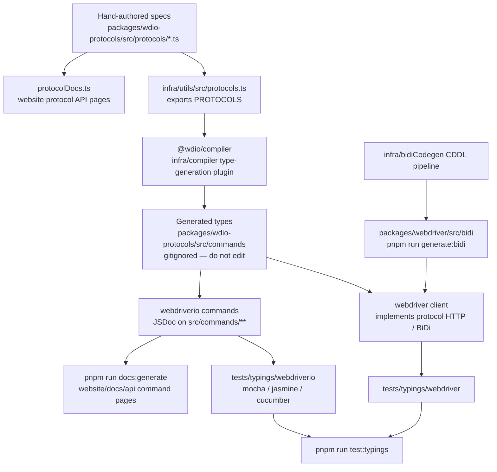

Cómo las especificaciones de protocolo se convierten en tipos de TypeScript, pruebas de tipado y documentación de la API.
Agentes: no editen manualmente los archivos generados; cambien la fuente indicada en este diagrama
y regeneren.

## Qué editar

| Quieres cambiar | Edita esto | Luego ejecuta |
|--------------------|-----------|----------|
| La estructura de un comando de WebDriver / Appium / de un proveedor | `packages/wdio-protocols/src/protocols/*.ts` | `pnpm run compile:all` y `pnpm run test:typings:webdriver` |
| Un comando `browser.*` / `$().*` de cara al usuario | `packages/webdriverio/src/commands/**` junto con su prueba unitaria y su fragmento de tipado | `pnpm run test:package webdriverio` y `pnpm run test:typings:webdriverio` |
| Tipos de BiDi | `infra/bidiCodegen/` | `pnpm run generate:bidi` |
| Texto de la documentación de la API de comandos | JSDoc en el comando de webdriverio | `pnpm run docs:generate` |
| Texto de la documentación de la API del protocolo | `description` / `ref` de la especificación del protocolo | `pnpm run docs:generate` |

Consulta también la [Descripción general de alto nivel](/docs/flowcharts/highleveloverview). Las especificaciones de protocolo
pertenecen a `packages/wdio-protocols`; el plugin del compilador se encuentra en
`infra/compiler/src/type-generation`.