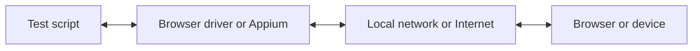

WebdriverIOでは、E2Eテストをローカルまたはクラウドで実行する際に、複数の自動化技術から選択できます。デフォルトでは、WebdriverIOは[WebDriver Bidi](https://w3c.github.io/webdriver-bidi/)プロトコルを使用してローカルの自動化セッションの開始を試みます。

## WebDriver Bidiプロトコル

[WebDriver Bidi](https://w3c.github.io/webdriver-bidi/)は、双方向通信を使用してブラウザを自動化するための自動化プロトコルです。これは[WebDriver](https://w3c.github.io/webdriver/)プロトコルの後継であり、さまざまなテストのユースケースに向けて、はるかに多くのイントロスペクション機能を提供します。

このプロトコルは現在開発中であり、今後新しいプリミティブが追加される可能性があります。すべてのブラウザベンダーがこのWeb標準の実装を約束しており、すでに多くの[プリミティブ](https://wpt.fyi/results/webdriver/tests/bidi?label=experimental&label=master&aligned)がブラウザに実装されています。

## WebDriverプロトコル

> [WebDriver](https://w3c.github.io/webdriver/)は、ユーザーエージェントのイントロスペクションと制御を可能にするリモートコントロールインターフェースです。プロセス外のプログラムがWebブラウザの動作をリモートで指示する手段として、プラットフォームおよび言語に依存しないワイヤープロトコルを提供します。

WebDriverプロトコルは、ユーザーの視点からブラウザを自動化するように設計されています。つまり、ユーザーが実行できることはすべて、ブラウザで実行できるということです。アプリケーションとの一般的なインタラクション(例:ナビゲーション、クリック、要素の状態の読み取りなど)を抽象化したコマンドのセットを提供します。Web標準であるため、すべての主要なブラウザベンダーで十分にサポートされており、[Appium](http://appium.io)を使用したモバイル自動化の基盤となるプロトコルとしても使用されています。

この自動化プロトコルを使用するには、すべてのコマンドを変換し、ターゲット環境(つまりブラウザやモバイルアプリ)で実行するプロキシサーバーが必要です。

ブラウザの自動化では、プロキシサーバーは通常ブラウザドライバーです。すべてのブラウザ向けにドライバーが用意されています:

- Chrome – [ChromeDriver](http://chromedriver.chromium.org/downloads)
- Firefox – [Geckodriver](https://github.com/mozilla/geckodriver/releases)
- Microsoft Edge – [Edge Driver](https://developer.microsoft.com/en-us/microsoft-edge/tools/webdriver/)
- Internet Explorer – [InternetExplorerDriver](https://github.com/SeleniumHQ/selenium/wiki/InternetExplorerDriver)
- Safari – [SafariDriver](https://developer.apple.com/documentation/webkit/testing_with_webdriver_in_safari)

あらゆる種類のモバイル自動化には、[Appium](http://appium.io)をインストールしてセットアップする必要があります。これにより、同じWebdriverIOのセットアップを使用して、モバイル(iOS/Android)やデスクトップ(macOS/Windows)アプリケーションまで自動化できます。

また、自動化テストをクラウド上で大規模に実行できるサービスも数多くあります。これらのドライバーをすべてローカルにセットアップする代わりに、クラウド上のこれらのサービス(例:[Sauce Labs](https://saucelabs.com))と通信するだけで、そのプラットフォーム上で結果を確認できます。テストスクリプトと自動化環境との間の通信は次のようになります:

